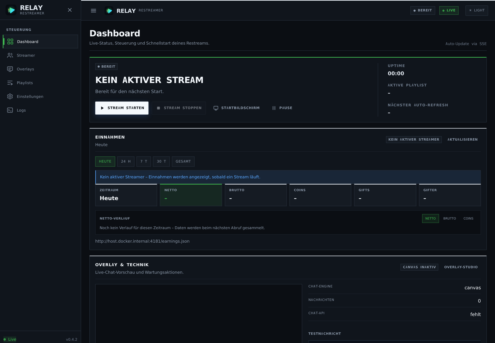
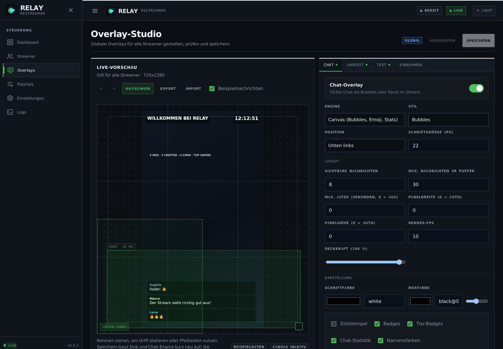
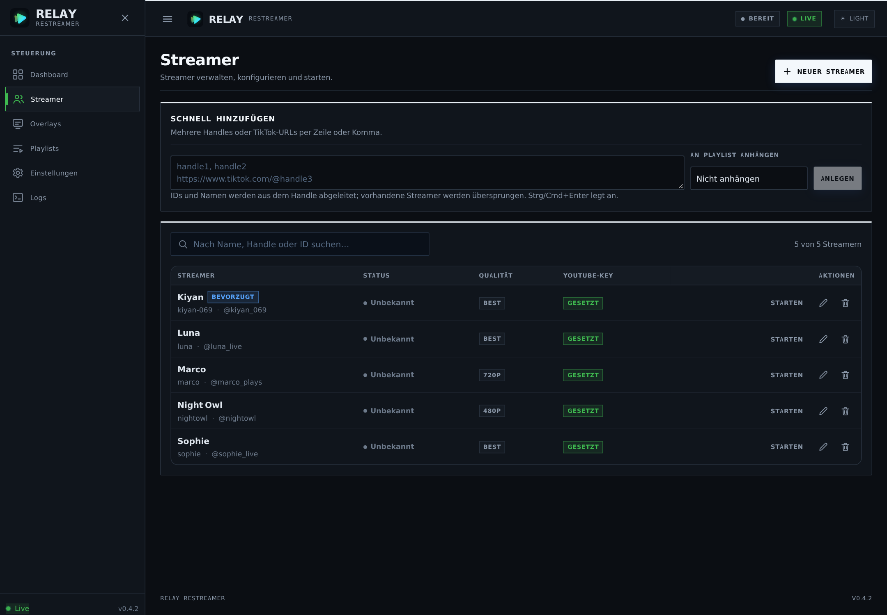
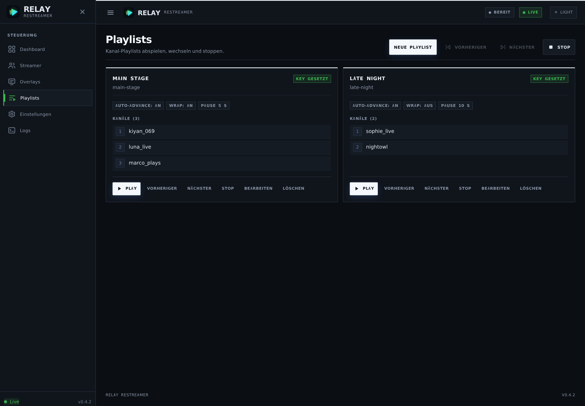
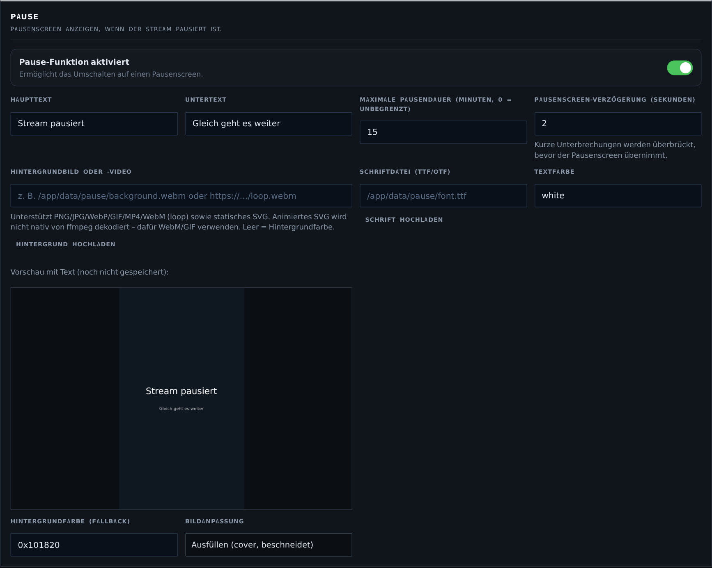
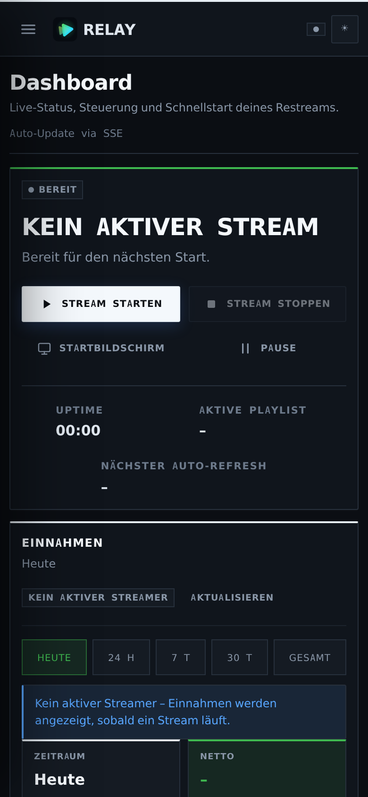

<div align="center">

# RELAY

**TikTok → YouTube Restreamer**

Node.js/TypeScript · Vue 3 · Canvas-Overlays · Docker

[](https://nodejs.org/)
[](./package.json)
[](https://www.typescriptlang.org/)
[](https://vuejs.org/)
[](https://www.docker.com/)
[](./LICENSE)

[Schnellstart](#schnellstart) · [Architektur](#architektur) · [Konfiguration](#konfiguration) · [API](#rest-api) · [Deployment](#deployment) · [Troubleshooting](#troubleshooting) · [Roadmap](./docs/ROADMAP.md)

</div>

---

RELAY ist ein eigenständiger Restreaming-Service: TikTok-Live wird über
`yt-dlp` und `ffmpeg` zu YouTube weitergeleitet. Ein interner MPEG-TS-Relay mit
Delay-Puffer hält die YouTube-Verbindung stabil, während Quellen gewechselt,
neu verbunden oder durch einen Pausenscreen ersetzt werden.

Dazu gibt es ein Vue-3-Dashboard im TokTracker-Stil mit Live-Updates per SSE,
globalen Overlays, Einnahmen-Monitor, Playlists, Telegram-Login und mobiler
Navigation.

> [!WARNING]
> Das Weiterleiten fremder Inhalte kann gegen die Nutzungsbedingungen von
> TikTok/YouTube und gegen Urheberrechte verstoßen. Nutze das Projekt nur für
> Inhalte, für die du die erforderlichen Rechte hast.

---

## Screenshots

| Dashboard | Overlay-Studio |
| --- | --- |
|  |  |

| Streamer | Playlists |
| --- | --- |
|  |  |

| Einstellungen | Mobile Dashboard |
| --- | --- |
|  |  |

---

## Funktionen

| Bereich             | Highlights                                                                                                           |
| ------------------- | -------------------------------------------------------------------------------------------------------------------- |
| **Streaming**       | TikTok → YouTube, Delay-Puffer mit Bitraten-Pacing, MPEG-TS-Relay, CBR-Output mit Filler-Frames, monotone Timestamps |
| **Stabilität**      | Watchdog für Quelle/Sink, Quell-Ratenüberwachung, Auto-Reconnect mit Backoff, Auto-Refresh der TikTok-URL            |
| **Pausenmodus**     | Pausenscreen statt RTMP-Trennung, konfigurierbare Grace-Periode, maximale Pausendauer, eigener Hintergrund/Font      |
| **Startbildschirm** | „Starting Soon“-Video/Bild vor dem ersten Live-Bild mit Dauer, Text und Font                                         |
| **Overlays**        | Canvas-Chat (Bubbles/Panel/Minimal), Emoji, Tier-Badges, Chat-Statistik, Uhr, Text, Einnahmen, drawtext-Fallback     |
| **Overlay-Studio**  | Bühnenvorschau aus Drafts, Drag/Resize, Live-Nachrichten, Presets, Hilfslinien, Undo/Redo, globale Persistenz        |
| **Playlists**       | Auto-Advance, Wrap, Dauer- oder tägliche Endzeit, Vor/Zurück, Kanäle direkt ansteuern                                |
| **Einnahmen**       | TokTracker-kompatibel, Verlauf/Charts, Delta, Zeitraum-Schnellwahl, Sessions, Gifts/Gifter, Kurse, Detailansicht     |
| **Dashboard**       | TokTracker-Design, SSE, Theme-Umschalter, Live-Menü, Live-Vorschau, responsive/mobile Ansicht, Drawer-Navigation     |
| **YouTube**         | OAuth-Verbindung, automatische Token-Erneuerung, Kanalstatus; Broadcast-Verwaltung folgt                               |
| **Auth**            | Passwort/Basic Auth, API-Token, Telegram-Login, Session-Liste, Bot-Steuerung und Benachrichtigungen                  |
| **Betrieb**         | Docker-Image mit ffmpeg, yt-dlp und Fonts, nginx-proxy/Let's-Encrypt-Override                                        |

---

## Schnellstart

```bash
cp .env.example .env
cp config/streamers.example.yml config/streamers.yml

# .env anpassen: Dashboard-Passwort, optional TikTok-Session/Telegram
# config/streamers.yml: Streamer und YouTube-Key eintragen

docker compose up -d --build
```

- Lokal: <http://127.0.0.1:3000>
- Öffentlich mit Reverse Proxy: <https://relay.positronium.dev>

Die Ports sind standardmäßig an `127.0.0.1` gebunden. Für öffentlichen Zugriff
einen Reverse Proxy davor setzen und Auth aktivieren.

### Stream-Key hinterlegen

Empfohlen: Keys nur in `.env` halten und in der YAML referenzieren.

```yaml
streamers:
  - id: mein_streamer
    name: Mein Streamer
    tiktok: mein_handle
    youtube_key_env: YOUTUBE_STREAM_KEY_MEIN
```

```dotenv
YOUTUBE_STREAM_KEY_MEIN=xxxx-xxxx-xxxx-xxxx-xxxx
```

Alternativ kann der Key im Dashboard eingegeben werden. Er wird dann in
`config/streamers.yml` mit Modus `0600` gespeichert.

---

## Architektur

```text
TikTok Live
    │  yt-dlp (URL, Format, Cookies)
    ▼
ffmpeg Quelle ──MPEG-TS──► Relay :12345
                              │
                              ▼
                       DelayBuffer (30 s, Pacing)
                              │
                              ▼
                       Playback :12346
                              │
                              ▼
ffmpeg Sink (720×1280, CBR, AAC) ──RTMP──► YouTube
```

Der DelayBuffer ist eine verlustfreie TCP-Verzögerungsleitung. Die Quelle
schreibt kontinuierlich MPEG-TS, der Puffer hält Pakete für die konfigurierte
Dauer zurück und gibt sie mit der gemessenen Quell-Bitrate getaktet aus.

Bei einem Quellenwechsel wird nur die Quelle neu gestartet. Sink und
YouTube-Verbindung bleiben bestehen. Jede neue Quelle erhält einen kumulativen
`-output_ts_offset`, damit MPEG-TS-Timestamps nicht rückwärts springen.

### Projektstruktur

```text
src/
├── api/                  Fastify, Auth, REST-Routen, SSE
├── core/
│   ├── config/           Zod-Schema, YAML-/ENV-Loader
│   ├── earnings/         TokTracker-kompatibler Einnahmen-Monitor
│   ├── overlays/         Canvas-Chat, drawtext, Pausenscreen, Studio-Preview
│   ├── online/           Online-Status-Monitor
│   ├── relay/            DelayBuffer, MPEG-TS-Relay
│   ├── sink/             YouTube-Sink
│   ├── source/           TikTok-Resolver, Quelle, ffmpeg-Builder
│   ├── store/            YAML-Store, Settings-Service
│   ├── supervisor/       Supervisor, Watchdog, Auto-Refresh
│   └── telegram/         Login-Bot und Token-Store
├── utils/                Logger, Prozesse, Dateien
└── web/                  Vue-3-Dashboard (Vite)

data/pause/               lokale Pause-/Start-Assets (nicht im Git)
tools/                    Asset-Renderer
tests/                    Vitest Unit-/Integrationstests
config/                   streamers.yml, settings.yml
docker/                   Entrypoint
```

---

## Dashboard

- **Dashboard:** Live-Status, Metriken, Schnellstart, Einnahmen-Detailkarte,
  Overlay-Vorschau und Wartungsaktionen. Das Live-Menü oben rechts zeigt den
  aktiven Stream und alle gerade live befindlichen Streamer; von dort lassen
  sie sich starten, wechseln und manuell beenden.
- **Streamer:** CRUD, Start/Stop/Wechsel, Online-Status, Sammel-Anlage per
  Handle/URL.
- **Overlays:** Globales Studio für Chat, Uhr, Text und Einnahmen.
- **Playlists:** Kanäle, Auto-Advance, Endzeit, Vor/Zurück und Tune.
- **Einstellungen:** Streaming, Watchdog, Pause, Online, Chat, Einnahmen.
- **Logs:** Live-Logringpuffer mit Level- und Textfilter.

Das UI nutzt das TokTracker-Design: harte Kanten, 1px-Rahmen, Mono-Labels,
grüner Akzent, Inter und JetBrains Mono (lokal gehostet). Auf Mobilgeräten
werden Sidebar, Tabellen, Formulare und Modals automatisch umgebaut.

---

## Konfiguration

Priorität:

```text
Defaults → streamers.yml (settings) → settings.yml → .env (nur fehlende Keys) → CLI
```

Dashboard-Werte in `config/settings.yml` gewinnen standardmäßig gegen `.env`.
Mit `SETTINGS_ENV_OVERRIDES=true` überschreibt `.env` die `settings.yml` bei
jedem Start.

### Wichtige Umgebungsvariablen

<details>
<summary>Server, Auth und Pfade</summary>

| Variable                           | Bedeutung                                       | Default                 |
| ---------------------------------- | ----------------------------------------------- | ----------------------- |
| `SERVER_HOST` / `SERVER_PORT`      | HTTP-Server                                     | `0.0.0.0` / `3000`      |
| `DASHBOARD_PASSWORD`               | Dashboard-Passwort (leer = kein Passwort-Login) | –                       |
| `API_TOKEN`                        | Bearer-Token für Skripte                        | –                       |
| `SESSION_SECRET`                   | Cookie-Signatur                                 | aus Passwort abgeleitet |
| `SECURE_COOKIES`                   | Cookies nur über HTTPS                          | `false`                 |
| `TRUST_PROXY`                      | Proxy-Header für Client-IPs vertrauen           | `false`                 |
| `SETTINGS_ENV_OVERRIDES`           | `.env` Vorrang vor `settings.yml`               | `false`                 |
| `STREAMERS_FILE` / `SETTINGS_FILE` | YAML-Pfade                                      | `config/...`            |
| `LOGS_DIR` / `DATA_DIR`            | Logs und Laufzeitdaten                          | `logs` / `data`         |

</details>

<details>
<summary>Streaming und Watchdog</summary>

| Variable                          | Bedeutung                                                    | Default        |
| --------------------------------- | ------------------------------------------------------------ | -------------- |
| `RELAY_PORT`                      | Ingest-Port (Playback = Port+1)                              | `12345`        |
| `RELAY_DELAY_SECONDS`             | Delay in Sekunden (`0` = aus)                                | `30`           |
| `OUTPUT_RESOLUTION`               | `720x1280`, `1280x720`, `1080x1920`, `1920x1080`, `1600x900` | `720x1280`     |
| `OUTPUT_FPS`                      | Bildrate                                                     | `25`           |
| `VIDEO_BITRATE` / `AUDIO_BITRATE` | kbit/s                                                       | `4000` / `128` |
| `X264_PRESET`                     | `ultrafast` … `medium`                                       | `veryfast`     |
| `VIDEO_ENCODER`                   | `auto`, `libx264`, `h264_qsv`, `h264_nvenc`, `h264_amf`      | `auto`         |
| `STALL_TIMEOUT`                   | Stall-Erkennung                                              | `30` s         |
| `MIN_BITRATE`                     | Mindestbitrate                                               | `500` kbit/s   |
| `SOURCE_MIN_RATE_PERCENT`         | Mindest-Quellrate                                            | `85` %         |
| `AUTO_REFRESH_MINUTES`            | TikTok-URL-Refresh                                           | `20` min       |
| `PAUSE_GRACE_SECONDS`             | Pausenscreen-Verzögerung                                     | `2` s          |
| `PAUSE_MAX_MINUTES`               | Maximale Pausendauer                                         | `15` min       |

</details>

<details>
<summary>Integrationen</summary>

| Variable                                      | Bedeutung                                   |
| --------------------------------------------- | ------------------------------------------- |
| `TIKTOK_SESSION_ID`                           | TikTok-`sessionid`-Cookie                   |
| `TELEGRAM_BOT_TOKEN`                          | Bot für Login-Freigaben                     |
| `TELEGRAM_ALLOWED_USER_IDS`                   | Erlaubte numerische Telegram-IDs            |
| `DASHBOARD_URL`                               | Öffentliche URL für Telegram-Links          |
| `ONLINE_SOURCE_URL` / `ONLINE_SOURCE_API_KEY` | Live-Status-Quelle                          |
| `ONLINE_AUTO_SWITCH_PREFERRED`                | Bevorzugten Streamer automatisch übernehmen |
| `CHAT_API_URL` / `CHAT_API_KEY`               | Chatquelle                                  |
| `GOOGLE_CLIENT_ID` / `GOOGLE_CLIENT_SECRET`   | YouTube-OAuth-Client (#18)                  |
| `GOOGLE_REDIRECT_URI`                         | Exakt im Google-Client hinterlegte Callback-URI |
| `YOUTUBE_AUTO_TRANSITION` / `_START` / `_STOP` | Broadcast-Automation (Default `true`)       |
| `YOUTUBE_DEFAULT_PRIVACY` / `_DVR`            | Defaults für neue Broadcasts                |
| `EARNINGS_PERIOD`                             | `today`, `24h`, `7d`, `30d`, `all`          |
| `EARNINGS_VIEW`                               | `compact`, `standard`, `detailed`           |
| `FFMPEG_BIN` / `YTDLP_BIN`                    | Binary-Pfade                                |

</details>

### `config/settings.yml`

<details>
<summary>Vollständiges Beispiel</summary>

```yaml
delay_buffer:
  enabled: true
  size: 30
  max_bytes: 32
video:
  resolution: 720x1280
  fps: 25
  video_bitrate: 4000
  audio_bitrate: 128
  preset: veryfast
watchdog:
  stall_timeout: 30
  min_bitrate: 500
  min_source_rate_percent: 85
  interval: 5
  auto_reconnect: true
  max_reconnect_delay: 60
auto_refresh:
  enabled: true
  interval: 20
pause:
  enabled: true
  text: 'Stream pausiert'
  subtext: 'Gleich geht es weiter'
  max_minutes: 15
  grace_seconds: 2
  background: ''
  font: ''
  text_color: white
  fit: cover
startup:
  enabled: false
  duration_seconds: 10
  text: 'Gleich geht’s los.'
  subtext: 'Der Stream startet in wenigen Minuten.'
  color: '0x101820'
  background: ''
  font: ''
  text_color: white
  fit: cover
online:
  enabled: false
  source_url: ''
  api_key: ''
  interval: 60
  auto_switch_preferred: false
chat:
  api_url: ''
  api_key: ''
overlays:
  chat: { enabled: true, engine: canvas, position: bottom-left, style: bubbles }
  clock: { enabled: false, position: top-right, format: '%H:%M:%S' }
  text: { enabled: false, position: top-left, text: '' }
streaming:
  title_template: '{name} – LIVE'
earnings:
  enabled: false
  source_url: ''
  api_key: ''
  interval: 300
  period: today
  view: standard
  overlay_enabled: false
  overlay_position: top-left
  overlay_template: '{net} € · {coins} Coins'
  overlay_font_size: 22
```

</details>

Änderungen werden atomar mit Modus `0600` geschrieben. Secrets werden in
API-Antworten durch `api_key_set` ersetzt und bleiben bei Teil-Updates erhalten.
Overlays gelten global für alle Streamer.

---

## Betrieb und Pause

Wenn die TikTok-Quelle endet, pausiert oder nicht auflösbar ist, bleibt der
YouTube-Sink aktiv. Nach `pause.grace_seconds` übernimmt der Pausenscreen als
Ersatzquelle im Relay; die RTMP-Verbindung wird nicht neu aufgebaut. Sobald die
Quelle wieder live ist, wird der Pausenscreen gestoppt.

`pause.max_minutes` begrenzt die Pause (`0` = unbegrenzt).
`PAUSE_GRACE_SECONDS=0` schaltet sofort um.

### Hintergrund und Font

`pause.background` akzeptiert lokale Pfade oder URLs:

- PNG/JPG/WebP
- animierte GIFs/WebPs
- MP4/WebM/MOV/MKV (geloopt)
- statisches SVG (wird mit Skia zu PNG gerastert)

`pause.font` setzt eine TTF/OTF-Datei, `pause.text_color` die Textfarbe und
`pause.fit` (`cover`, `contain`, `stretch`) die Bildanpassung. `stretch` füllt
die aktuelle Ausgabeauflösung exakt aus, ohne den unteren Bildteil
abzuschneiden. Dateien im Container z. B. unter `/app/data/pause/` ablegen.
Hintergrund und Font können im Dashboard direkt hochgeladen, validiert und als
Vorschau angezeigt werden; die API liegt unter `/api/pause/assets`. Uploads sind
auf 50 MB begrenzt und werden anhand von Endung und Magic Bytes geprüft.

> [!NOTE]
> ffmpeg kann animierte SVGs nicht nativ dekodieren. Sie werden als statisches
> Bild verwendet. Für echte Animation das SVG zu WebM/GIF/MP4 konvertieren.

### Startbildschirm

Der optionale Startbildschirm läuft nur beim Start aus dem Idle-Zustand, bevor
die erste TikTok-Quelle übernimmt:

```yaml
startup:
  enabled: true
  duration_seconds: 8
  text: 'Gleich geht’s los.'
  subtext: 'Der Stream startet in wenigen Minuten.'
  background: /app/data/pause/starting-soon.mp4
  fit: stretch
```

Während der Dauer bleibt der YouTube-Sink aktiv; danach wird die Quelle ohne
RTMP-Neuaufbau gestartet. Hintergrund, Font und Uploads nutzen dieselbe
Asset-API wie der Pausenscreen (`/api/pause/assets`). Ohne gültiges Asset wird
`startup.color` als Hintergrund verwendet.

Pause- und Startbildschirm-Assets sind bewusst **nicht im Repository**. Sie
liegen lokal unter `data/pause/` (gitignored) und werden über das Dashboard oder
die Asset-API hochgeladen. Beispiel:

```text
data/pause/starting-soon.mp4
data/pause/pausenscreen.mp4
```

`pause.background` bzw. `startup.background` verweisen dann auf
`/app/data/pause/<datei>`.

Per-Streamer-Overlays aus älteren YAML-Dateien werden beim Laden ignoriert und
beim nächsten Speichern entfernt. Maßgeblich ist immer `settings.overlays` im
Dashboard; vorhandene Overlay-Werte des ersten aktiven Streamers werden beim
ersten Start einmalig nach `settings.yml` migriert.

### Manuelle Screens

Auf dem Dashboard lassen sich **Startbildschirm** und **Pausenscreen** jederzeit
per Knopfdruck einspielen – unabhängig davon, ob die TikTok-Quelle gerade läuft,
pausiert oder gar kein Streamer aktiv ist:

- **Startbildschirm** → eigenes Startvideo
- **Pause** → Pausenscreen
- **Beenden** → zurück zur aktiven Quelle bzw. in den Idle-Zustand

Ohne aktiven Streamer wird der Screen über den YouTube-Key des bevorzugten
(sonst ersten aktivierten) Streamers gesendet; fehlt dort ein Key, greift
`YOUTUBE_STREAM_KEY` aus der `.env`. Die manuellen Screens bleiben aktiv, bis du
sie beendest; die automatische `pause.max_minutes`-Grenze gilt nur für
Offline-Pausen. Die YouTube-/RTMP-Verbindung bleibt währenddessen bestehen.

---

## Auth und Telegram

Passwort-Login, Basic Auth und API-Token funktionieren parallel. Optional kann
der Dashboard-Login per Telegram-Bot freigegeben werden. Cookie-authentifizierte
schreibende Anfragen benötigen einen passenden `Origin`/`Referer`; API-Token und
Basic Auth sind davon ausgenommen. Tokens werden nicht mehr als Query-Parameter
akzeptiert.

```dotenv
TELEGRAM_BOT_TOKEN=123456:ABC...
TELEGRAM_ALLOWED_USER_IDS=123456789
SECURE_COOKIES=true
```

Ablauf:

1. **Mit Telegram anmelden** im Dashboard wählen.
2. Der Bot öffnet sich mit einem einmaligen Token (10 Minuten gültig).
3. Im Bot **Anmelden freigeben** drücken.
4. Der Browser erhält ein signiertes HttpOnly-Cookie (30 Tage).

Sessions werden serverseitig in `data/sessions.json` (Modus `0600`) verwaltet.
Sie überleben Neustarts, können aber jederzeit widerrufen werden. Unter
**Einstellungen → Sessions** lassen sich alle Anmeldungen einsehen und einzeln
oder komplett abmelden. Die API bietet dafür `GET /api/auth/sessions`,
`POST /api/auth/sessions/:id/revoke` und `POST /api/auth/sessions/revoke-all`.

### Bot-Steuerung

Der Bot ist nach der Freigabe auch eine Fernsteuerung:

- `/status` – Zustand, Streamer, Quelle, Sink und Uptime
- `/menu` – Inline-Buttons für Status, Start/Stop, Playlist und Logs
- `/streamers` – Streamer starten, wechseln, anlegen, bearbeiten, löschen
- `/playlists` – Playlists starten und verwalten
- `/stop`, `/next`, `/prev`, `/pause`
- `/screens` – Start- und Pausenscreen ein-/ausschalten
- `/overlays` – Chat, Uhr und Text einzeln umschalten
- `/settings` – wichtige Einstellungen anzeigen
- `/earnings [Zeitraum]` – Einnahmen mit Zeitraum-Buttons
- `/youtube` – Broadcasts anzeigen und mit Bestätigung steuern
- `/sessions` – Dashboard-Sessions anzeigen und widerrufen
- `/media` – lokale Videos in `data/media`
- `/logs [n]` – letzte Logzeilen
- `/notify` – Benachrichtigungen gesamt oder je Kategorie umschalten
  (`live`, `reconnect`, `error`)

Destruktive Aktionen (`/stop`, Session-Widerruf, YouTube-Status) verlangen eine
Bestätigung. Die vollständige Befehls- und Paritätsübersicht steht in
[`docs/TELEGRAM.md`](docs/TELEGRAM.md).

Benachrichtigungen gehen an `TELEGRAM_NOTIFY_CHAT_ID`, sonst an die erste ID aus
der Allow-List. Die Schalter werden in `data/telegram-notify.json` gespeichert;
`TELEGRAM_NOTIFICATIONS=false` deaktiviert sie beim Start standardmäßig.

Nur private Chats von IDs aus `TELEGRAM_ALLOWED_USER_IDS` werden akzeptiert.
Ohne Token oder Allow-List bleibt Telegram-Login deaktiviert (fail-closed).
Die gleiche Bot-Token darf nicht parallel in einer zweiten Instanz laufen.

### Live-Vorschau

Das Dashboard kann den aktiven Relay-Stream direkt im Browser abspielen
(MPEG-TS über MSE/mpegts.js). Die Vorschau ist ein separater Tap am Relay und
startet oder stoppt **nie** den YouTube-Sink. Sie zeigt die Quelle mit geringer
Latenz (typisch 1–3 s), aber ohne die im Sink gerenderten Overlays.

- Authentifizierter Endpunkt: `GET /api/preview.ts`
- Player: Start/Stop, Ton, Vollbild und Neuladen
- Kein Zugriff auf Stream-Keys oder YouTube-APIs
- Benötigt einen Browser mit Media Source Extensions (Chrome/Firefox/Edge)

### YouTube-Verbindung

Unter **YouTube** im Dashboard lässt sich ein Google-Konto per OAuth verbinden.
RELAY speichert den Refresh-Token serverseitig in `data/youtube-auth.json`
(Modus `0600`), erneuert Access-Tokens automatisch und widerruft den Zugriff
beim Trennen. Tokens erscheinen weder in API-Antworten noch in Logs.

- Einrichtung: siehe [`docs/YOUTUBE.md`](docs/YOUTUBE.md)
- Benötigt `GOOGLE_CLIENT_ID`, `GOOGLE_CLIENT_SECRET`, `GOOGLE_REDIRECT_URI`
- Scope: `youtube.force-ssl`; App muss für Dauerbetrieb `In production` sein
- Broadcast-Verwaltung folgt im weiteren Verlauf von #18

---

## Overlays und Studio

Es gibt zwei Chat-Engines:

- **Canvas (Standard):** `@napi-rs/canvas` rendert den Chat als transparente
  RGBA-Frames, die als zweiter ffmpeg-Input (`pipe:3`) eingeblendet werden.
  Bubbles, Namen, Emoji, Badges, Statistik und Timestamps funktionieren ohne
  RTMP-Neustart.
- **drawtext (Fallback):** schreibt den Chat in eine Textdatei, die ffmpeg mit
  `reload=1` neu einliest. Leichtgewichtig, aber ohne farbige Emoji.

Das Overlay-Studio rendert die komplette Bühne (Chat, Uhr, Text, Einnahmen)
serverseitig aus **ungespeicherten** Drafts. Die Vorschau wird clientseitig
entprellt und mit `AbortController` abgebrochen. Overlays lassen sich direkt im
Bild ziehen (freie `offset_x`/`offset_y`-Offsets), am Griff skalieren oder per
Pfeiltasten verschieben; ein Klick auf eine Ecke setzt die Position exakt.
Zusätzlich gibt es Hilfslinien (Sicherheitsrand und Drittel), Undo/Redo sowie
Preset-Import/-Export als JSON. Ohne „Beispielnachrichten“ zeigt die Vorschau
die zuletzt empfangenen echten Chat-Nachrichten. Das Einnahmen-Overlay ist eine
eigene Studio-Sektion mit mehrzeiligem Template, Position, Offsets,
Schriftgröße, Farben und Box-Toggle; Quelle, Zeitraum und Dashboard-Ansicht
bleiben unter Einstellungen. Zeilenumbrüche aus dem Template werden in Vorschau
und Stream übernommen.

Die Sektion **Video** skaliert und verschiebt das TikTok-Live-Bild global:
100 % entspricht dem eingepassten Bild, über 100 % wird gezoomt und an den
Rändern beschnitten. Die Vorschau zeigt ein schematisches Quellformat
(9:16/16:9/1:1). Das Layout gilt auch für Pause-/Startbildschirm und lokale
Videos.
Speichern schreibt global nach `config/settings.yml` und baut bei einem laufenden
Stream Chat-Engine/Sink kontrolliert neu auf.

Chat-Optionen umfassen Panel/Minimal-Stil, Nachrichtenpuffer,
maximales Nachrichtenalter, feste Panelhöhe, Namensfarben, Tier-Badges und
Chat-Statistik. Uhr und Text haben eigene Ränder und optionale Hintergrundboxen.

**Chat-API:** JSON mit Nachrichten unter `messages`, `comments`, `chat`,
`items`, `data`, `results` oder direkt. Unterstützte Felder:
`username`/`user`/`uniqueId`/`nickname` und
`comment`/`text`/`message`/`content`. `{handle}` wird ersetzt; API-Key als
`X-API-Key` und `Authorization: Bearer`.

---

## Playlists

Playlists referenzieren Streamer-IDs, TikTok-Handles oder lokale Videos und
lassen sich im Dashboard verwalten. Fehlt ein Streamer, wird ein temporärer
Eintrag erzeugt.

Lokale Videos liegen unter `data/media/` (gitignored) und werden als
`file:dateiname.mp4` in die Playlist eingetragen. Im Playlist-Editor können
vorhandene Dateien ausgewählt und eingefügt werden; die Liste aktualisiert sich
alle fünf Sekunden bzw. über **Aktualisieren**, damit auch extern abgelegte
Dateien erscheinen. Abgespielt wird einmalig in Echtzeit, danach geht es
automatisch zum nächsten Eintrag. Unterstützt werden MP4, WebM, MOV, MKV und
M4V. Der YouTube-Sink bleibt dabei bestehen.

- `auto_advance` wechselt bei Offline-Quelle nach `advance_delay_seconds`.
- `wrap` springt am Ende zum Anfang.
- `end_after_minutes` beendet nach Dauer.
- `end_time: "23:00"` beendet täglich zur festen Uhrzeit (Vorrang).
- Ein gemeinsamer `youtube_key` hält die YouTube-Verbindung beim Wechsel offen.
- Streamer mit `own_stream: true` behalten ihren eigenen Key.
- Vor/Zurück und direktes Ansteuern einzelner Kanäle sind im Dashboard möglich.

---

### Delay-Puffer und Kaltstart

Ist der Delay-Puffer aktiv, startet der YouTube-Sink erst, wenn der Puffer
gefüllt ist. Dadurch verbindet sich YouTube direkt mit Medien statt mit einer
langen Stille; der Cold-Start dauert entsprechend der eingestellten
Puffergröße (`delay_buffer.size`) länger. Bei kleinen Werten (z. B. 5 s) ist der
Screen schneller auf YouTube, bei 20 s dauert der erste Verbindungsaufbau
entsprechend länger.

## Einnahmen

Der Monitor liest TokTracker-kompatibles JSON und zeigt Werte im Dashboard
sowie optional im Stream-Overlay.

```dotenv
EARNINGS_ENABLED=true
EARNINGS_SOURCE_URL=https://positronium.dev/track/api/public/overview
EARNINGS_SOURCE_API_KEY=dein-key
EARNINGS_REFRESH_SECONDS=300
EARNINGS_PERIOD=today
EARNINGS_VIEW=detailed
```

**Zeiträume:** `today`, `24h`, `7d`, `30d`, `all` – direkt im Dashboard
umschaltbar, ohne die Einstellungen zu öffnen.
**Ansichten:** `compact`, `standard`, `detailed`.

Die Detailansicht enthält Netto, Brutto, Coins, Gifts, Gifter, Session,
Zuschauer, Follower, Top-Gift, Top-Gifter, zuletzt gesehen, Kurse und
Monitor-Diagnose. Fehlende Geldwerte werden aus Coins und `rates` berechnet.
Bei temporären Fehlern bleiben letzte Werte sichtbar; fehlende Streamer werden
als „keine Daten“ markiert.

Zusätzlich speichert der Monitor einen kompakten Verlauf in
`data/earnings-history.json` (nur Aggregate, keine Nutzernamen; 90 Tage bzw.
maximal 4000 Punkte). Das Dashboard zeigt daraus einen Netto-/Brutto-/Coins-Chart,
das Delta seit dem ersten Punkt des Zeitraums sowie einen „Veraltet“-Hinweis,
wenn die Daten älter als fünf Minuten sind.

**API:** `GET /api/earnings`, `GET /api/earnings/history?period=7d`,
`POST /api/earnings/period`, `POST /api/earnings/refresh`.

Das Einnahmen-Overlay wird im **Overlay-Studio → Einnahmen** gestaltet
(Template, Position, Offsets, Schriftgröße, Farben, Box). Die Einstellungen
enthalten nur noch Quelle, Intervall, Zeitraum und Dashboard-Ansicht.

**Overlay-Platzhalter:** `{period}`, `{net}`, `{gross}`, `{coins}`, `{gifts}`,
`{gifters}`, `{session_net}`, `{session_gross}`, `{session_coins}`,
`{viewers}`, `{followers}`, `{live}`, `{top_gift}`, `{top_gifter}`,
`{display_name}`, `{last_seen}`, `{name}`, `{username}`, `{currency}`.

---

## Online-Monitor

Der Live-Status kommt aus einer konfigurierbaren JSON-API (z. B. TokTracker):

```dotenv
ONLINE_CHECK_ENABLED=true
ONLINE_SOURCE_URL=https://positronium.dev/track/api/public/overview
ONLINE_SOURCE_API_KEY=dein-key
ONLINE_CHECK_INTERVAL_SECONDS=60
ONLINE_AUTO_SWITCH_PREFERRED=false
```

Ausgewertet wird `is_live` der Einträge im `streamers`-Array. Der Status ist
eine Planungshilfe; ob wirklich live, entscheidet beim Start weiterhin
`yt-dlp`. Mit `auto_switch_preferred` wird ein bevorzugter Streamer automatisch
übernommen. Endet dieser Stream, kehrt RELAY zur vorherigen Playlist bzw. zum
vorherigen Streamer an derselben Position zurück.

Mehrere bevorzugte oder zum Auto-Start markierte Streamer werden über das Feld
`priority` geordnet (kleinere Zahl = höhere Priorität). Ohne gesetzte Priorität
gelten bevorzugte Streamer vor anderen und danach der Name als stabiler
Tie-Breaker.

---

## REST API

Alle `/api`-Routen sind geschützt, sobald Passwort oder API-Token gesetzt sind.
Login per `POST /api/auth/login` setzt ein signiertes HttpOnly-Cookie; für
Skripte eignet sich `Authorization: Bearer <API_TOKEN>` oder Basic Auth.

Die vollständige OpenAPI-3.1-Spezifikation liegt unter `docs/openapi.json` und
wird von `GET /api/openapi.json` ausgeliefert. Erzeugen und prüfen:

```bash
npm run openapi:generate
npm run openapi:check
```

Details: [`docs/OPENAPI.md`](docs/OPENAPI.md).

<details>
<summary>Auth</summary>

| Methode | Endpunkt                        | Beschreibung                    |
| ------- | ------------------------------- | ------------------------------- |
| `POST`  | `/api/auth/login`               | `{ password }` → Session-Cookie |
| `GET`   | `/api/auth/methods`             | Verfügbare Login-Methoden       |
| `POST`  | `/api/auth/telegram/request`    | Telegram-Token + Deep-Link      |
| `POST`  | `/api/auth/telegram/check`      | Freigabe prüfen, Cookie setzen  |
| `POST`  | `/api/auth/logout`              | Session beenden                 |
| `GET`   | `/api/auth/sessions`            | Aktive Sessions                 |
| `POST`  | `/api/auth/sessions/:id/revoke` | Einzelne Session widerrufen     |
| `POST`  | `/api/auth/sessions/revoke-all` | Alle Sessions widerrufen        |
| `GET`   | `/api/auth/me`                  | Auth-Status                     |

</details>

<details>
<summary>Streamer und Status</summary>

| Methode  | Endpunkt                    | Beschreibung                      |
| -------- | --------------------------- | --------------------------------- |
| `GET`    | `/api/streamers`            | Streamer inkl. Status (ohne Keys) |
| `POST`   | `/api/streamers`            | Streamer anlegen                  |
| `PUT`    | `/api/streamers/:id`        | Streamer aktualisieren            |
| `DELETE` | `/api/streamers/:id`        | Streamer löschen                  |
| `POST`   | `/api/streamers/:id/start`  | Stream starten                    |
| `POST`   | `/api/streamers/:id/stop`   | Stream stoppen                    |
| `POST`   | `/api/streamers/:id/switch` | Zu Streamer wechseln              |
| `GET`    | `/api/streamers/:id/title`  | YouTube-Titel-Vorschau            |
| `POST`   | `/api/quickstart`           | Handle + Key anlegen und starten  |
| `GET`    | `/api/status`               | Vollständiger Systemstatus        |
| `GET`    | `/api/media`                | Lokale Playlist-Videos listen      |
| `GET`    | `/api/preview.ts`           | Live-Vorschau als MPEG-TS          |
| `GET`    | `/api/youtube/status`       | YouTube-Verbindung ohne Tokens      |
| `GET`    | `/api/youtube/broadcasts`   | Broadcasts inkl. Ingest-Health      |
| `POST`   | `/api/youtube/broadcasts`   | Broadcast anlegen und binden        |
| `PUT`    | `/api/youtube/broadcasts/:id` | Metadaten und Zeitplan ändern     |
| `POST`   | `/api/youtube/broadcasts/:id/publish` | Broadcast öffentlich stellen |
| `POST`   | `/api/youtube/broadcasts/:id/transition` | `testing`, `live`, `complete` |
| `POST`   | `/api/youtube/broadcasts/:id/assign` | Ingest eines Streamers binden |
| `DELETE` | `/api/youtube/broadcasts/:id` | Broadcast löschen                 |
| `GET`    | `/api/youtube/oauth/start`  | Google-Zustimmungs-URL             |
| `POST`   | `/api/youtube/oauth/disconnect` | YouTube-Verbindung trennen     |
| `GET`    | `/api/earnings`             | Ausführlicher Einnahmen-Status    |
| `GET`    | `/api/earnings/history`     | Verlauf für einen Zeitraum        |
| `POST`   | `/api/earnings/period`      | Zeitraum-Schnellwahl speichern    |
| `POST`   | `/api/earnings/refresh`     | Einnahmen sofort aktualisieren    |
| `GET`    | `/api/events`               | SSE: Status, Streamer, Logs       |

</details>

<details>
<summary>Playlists und Steuerung</summary>

| Methode  | Endpunkt                           | Beschreibung                     |
| -------- | ---------------------------------- | -------------------------------- |
| `GET`    | `/api/playlists`                   | Playlists                        |
| `POST`   | `/api/playlists/:id/play`          | Playlist starten                 |
| `POST`   | `/api/playlists/next`              | Nächster Eintrag                 |
| `POST`   | `/api/playlists/previous`          | Vorheriger Eintrag               |
| `POST`   | `/api/playlists/:id/tune/:channel` | Kanal direkt ansteuern           |
| `POST`   | `/api/playlists/stop`              | Playlist stoppen                 |
| `POST`   | `/api/reload`                      | `streamers.yml` neu laden        |
| `POST`   | `/api/online/check`                | Online-Status sofort prüfen      |
| `POST`   | `/api/screens/:type/start`         | `startup`/`pause` manuell zeigen |
| `POST`   | `/api/screens/stop`                | Manuellen Screen beenden         |
| `POST`   | `/api/pause/start` / `stop`        | Pausenscreen an/aus              |
| `GET`    | `/api/pause/assets`                | Hochgeladene Pause-Dateien       |
| `POST`   | `/api/pause/assets`                | Hintergrund/Font hochladen       |
| `POST`   | `/api/pause/preview.png`           | Screen-Vorschau mit Text         |
| `GET`    | `/api/pause/assets/:filename`      | Pause-Datei ausliefern           |
| `DELETE` | `/api/pause/assets/:filename`      | Pause-Datei löschen              |
| `POST`   | `/api/system/restart-sink`         | Encoder neu starten              |
| `POST`   | `/api/system/refresh`              | Quell-URL erneuern               |

</details>

<details>
<summary>Settings, Overlays und Logs</summary>

| Methode       | Endpunkt                               | Beschreibung                  |
| ------------- | -------------------------------------- | ----------------------------- |
| `GET` / `PUT` | `/api/settings`                        | Einstellungen lesen/speichern |
| `GET`         | `/api/overlays/preview.png`            | Live-Chat-Overlay als PNG     |
| `POST`        | `/api/overlays/studio.png`             | Studio-Vorschau aus Draft     |
| `PUT`         | `/api/overlays`                        | Globale Overlays speichern    |
| `POST`        | `/api/chat/test`                       | Testnachricht einspeisen      |
| `GET`         | `/api/logs?limit=200&level=warn&q=...` | Log-Ringpuffer                |
| `DELETE`      | `/api/logs`                            | Log-Ringpuffer leeren         |
| `GET`         | `/health`                              | Healthcheck (öffentlich)      |

</details>

```bash
curl -u user:password http://127.0.0.1:3000/api/status
curl -H "Authorization: Bearer $API_TOKEN" \
     -X POST http://127.0.0.1:3000/api/streamers/alpha/start
```

---

## Deployment

### nginx-proxy und Let's Encrypt

Eine Override-Vorlage liegt bei:

```bash
cp docker-compose.override.example.yml docker-compose.override.yml
# VIRTUAL_HOST, LETSENCRYPT_HOST und E-Mail anpassen
docker compose up -d --build
```

Die Vorlage erwartet `nginx-proxy` und `acme-companion` sowie das externe Netz
`toktrackerapp_toktracker_net`. Die produktive Konfiguration zeigt auf
`relay.positronium.dev`. Bei HTTPS muss `SECURE_COOKIES=true` gesetzt sein.

### Sicherheits-Checkliste

1. `DASHBOARD_PASSWORD` oder Telegram-Login aktivieren, wenn der Port nicht nur
   lokal erreichbar ist.
2. Stream-Keys über Environment-Variablen, nicht ins Repository.
3. Reverse Proxy mit TLS; `SECURE_COOKIES=true`.
4. Relay-Ports `12345`/`12346` nicht öffentlich exponieren.
5. `.env`, `config/streamers.yml`, `config/settings.yml`, `data/` und `logs/`
   niemals committen.
6. Container läuft als UID/GID 1001 mit `no-new-privileges`.

---

## Betrieb und Monitoring

### Health und Metriken

`GET /health` ist ohne Anmeldung erreichbar und liefert neben Status/Version
auch Source-, Relay-, Sink- und Pause-Details. Für das Monitoring gibt es
zusätzlich JSON-Metriken ohne weitere Abhängigkeit:

```bash
curl -fsS https://relay.positronium.dev/health
curl -fsS -H "Authorization: Bearer $API_TOKEN" \
  https://relay.positronium.dev/api/metrics
```

`/api/metrics` liefert `started_at`, `uptime_seconds` und Zähler wie
`source_exits_total`, `source_reconnects_total`, `reconnect_success_total`,
`reconnect_failures_total`, `pause_starts_total`, `pause_limit_hits_total`,
`sink_restarts_total`, `watchdog_triggers_total`, `playlist_advances_total`,
`manual_screens_total`, `startup_screens_total`, `chat_poll_errors_total` und
`earnings_poll_errors_total`.

### Backup und Restore

```bash
scripts/backup.sh                        # -> backups/relay-<timestamp>.tar.gz
scripts/backup.sh /pfad/ziel.tar.gz
scripts/restore.sh backups/relay-....tar.gz          # mit Rückfrage
scripts/restore.sh backups/relay-....tar.gz --force  # ohne Rückfrage
```

Gesichert werden `config/` und `data/`. Ausgeschlossen sind
`data/sessions.json` (Sessions werden nach dem Restore neu erstellt) und
`data/overlays/active` (Laufzeitdateien). Das Archiv wird mit Modus `0600`
angelegt; die Scripts geben keine Secrets aus. `backups/` ist gitignored.

### Logrotation

- Docker: Der Container schreibt in den `json-file`-Treiber; `docker-compose.yml`
  begrenzt das auf 10 MB pro Datei und drei Dateien.
- Bare Metal: `logs/restreamer.log` per `logrotate` wöchentlich rotieren und
  `copytruncate` verwenden, weil der Prozess die Datei offen hält.

---

## Entwicklung

Voraussetzungen:

- Node.js **20.19+** (empfohlen: 22 LTS)
- `ffmpeg` und `yt-dlp` im `PATH` (oder `FFMPEG_BIN`/`YTDLP_BIN`)

```bash
npm ci
cp .env.example .env
npm run dev          # Backend auf :3000
npm run dev:web      # Vite auf :5173, Proxy /api -> :3000
```

Produktionsbuild und Checks:

```bash
npm run build          # tsc + vite
npm run check          # Typecheck + Vue-Typecheck + ESLint + Tests
npm test               # Vitest
npm run test:e2e:install  # Chromium für Playwright (einmalig)
npm run test:e2e       # Mobile/A11y-E2E, startet den Dev-Server selbst
```

Accessibility-Checkliste und Kontrastwerte: [`docs/ACCESSIBILITY.md`](./docs/ACCESSIBILITY.md).

---

## Troubleshooting

- **EADDRINUSE:** Ein anderer Prozess nutzt `RELAY_PORT`/`RELAY_PORT+1` oder
  `SERVER_PORT`. Beim Umstieg von der Python-Version den alten Container
  stoppen (dort ist der Relay-Port standardmäßig `19350`).
- **yt-dlp 403/„not live“:** TikTok-Session-Cookie erneuern, Handle prüfen,
  aktuelles Image/`yt-dlp` verwenden.
- **„not live“, obwohl live:** Manche TikTok-Lives sind login-/zugriffsgeschützt.
  Der Service fällt auf die TikTok-Mobile-Live-API mit `data/cookies.txt`
  zurück. Ggf. eine frische Session eines berechtigten Accounts setzen.
- **Kein Dashboard:** `npm run build:web` ausführen; im Docker-Build passiert
  das automatisch.
- **Hohe CPU:** `video_mode: copy`, Auflösung/FPS senken oder
  `preset: ultrafast` verwenden.
- **Kein Bild:** `GET /api/status` prüfen (`source.connected`,
  `relay.output_connected`, `sink.running`).
- **Overlays fehlen:** Im Docker-Image sind Fonts enthalten. Lokal
  `font-dejavu` installieren oder `OVERLAY_FONT` setzen.
- **Pausenscreen ohne Animation:** Animiertes SVG wird nur statisch gerendert;
  WebM/GIF/MP4 verwenden.
- **Logrotation:** `logs/restreamer.log` schreiben; `logrotate` oder
  Docker-Log-Rotation konfigurieren.

---

## Umstieg von der Python-Version

Die YAML-Struktur (`streamers`, `playlists`, `channels`, `youtube_key`,
`video_mode`, `own_stream`) wird weitgehend gelesen.

1. Konfiguration kopieren, nicht gemeinsam beschreiben:
   `cp /pfad/restreamer/config/streamers.yml ./config/streamers.yml`
2. Unterschiedliche Ports verwenden. Die Python-Version nutzt standardmäßig
   `RELAY_PORT=19350`; dieses Projekt `12345`.
3. Nur ein Dienst darf denselben YouTube-Key gleichzeitig mit unterschiedlichen
   Inhalten bespielen.
4. `TIKTOK_SESSION_ID` und ggf. `cookies.txt` übernehmen.
5. Erst den alten Dienst stoppen, dann RELAY starten und Logs prüfen.

---

## Designentscheidungen

- **YAML statt LowDB:** menschenlesbare, atomar geschriebene Konfiguration.
- **Canvas + drawtext:** native Canvas-Engine für den Chat, drawtext als
  leichtgewichtiger Fallback für Uhr/Text.
- **Sink immer neu kodiert:** CBR mit Filler-Frames und monotonen Timestamps
  ist für YouTube robuster als `-c copy`, besonders nach Reconnects.
- **TypeScript durchgängig:** Backend, Shared Types, Vue-Dashboard und
  serverseitige Canvas-Preview.
- **Aktuelle Major-Versionen:** Fastify 5, Zod 4, Vue 3.5, Vite 7, Node 22 LTS.

---

## Lizenz

MIT – siehe [LICENSE](./LICENSE).
