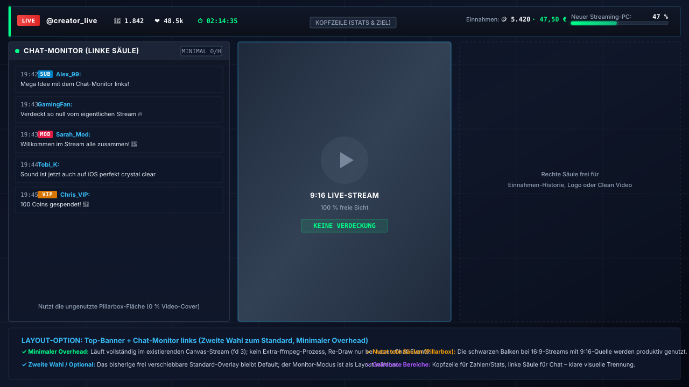

## Ziel

Ein integriertes, horizontales Top-Banner-Overlay als alternatives Anzeigeformat bereitstellen, das Einnahmen, Stream-Statistiken und die neuesten Chat-Nachrichten kompakt in einer Leiste am oberen Bildrand bündelt, anstatt Bildfläche an den Seiten zu verdecken.

## Hintergrund

- Aktuell werden Chat, Einnahmen und Statistiken als separate Boxen oder vertikale Seiten-Panels gerendert (z. B. links oder rechts im Stream).
- Insbesondere bei 9:16-Handy-Streams oder 16:9-Formaten mit zentrierter Live-Quelle verdecken vertikale Chat-Panels und frei platzierte Overlays wichtige Teile des Inhalts (z. B. Gesichter, Gameplay oder Produktanzeigen).
- Ein horizontales Top-Banner (nach dem Vorbild moderner News-Ticker oder TV-Kopfzeilen) nutzt den oberen Bildbereich effizient aus:
  - Links: Live-Status & Stream-Statistiken (Zuschauer, Likes, Streamer-Name).
  - Mitte: Letzte Chat-Nachrichten als einzeiliger Ticker oder weich einblendende Blase.
  - Rechts: Einnahmen-Zusammenfassung (Coins/EUR) samt kompaktem Spendenziel-Fortschrittsbalken.

## Mockup

*Abbildung: Horizontales Top-Banner mit Status & Stream-Stats (links), Chat-Ticker (Mitte) und Einnahmen & Spendenziel (rechts). Der Hauptstream bleibt vollständig unverdeckt.*

## Umfang

- **Canvas-Rendering (`src/core/overlays/` & `chat-engine.ts`):**
  - Neuer Layout-Modus für Overlays: `banner-top` (z. B. in Chat-Style oder als eigenständiges Banner-Modul).
  - Konfigurierbare Banner-Höhe (z. B. 48–96 px), Hintergrundfarbe mit Alpha-Deckkraft und Akzentrahmen.
  - Drei Banner-Segmente:
    1. *Stats-Segment:* Uptime, TikTok-Zuschauer, Likes und aktiver Streamer-Name.
    2. *Chat-Segment:* Einzeiliger Lauftext (Marquee) oder sanft überblendende Einzelnachrichten mit Username-Farbe und Badges.
    3. *Einnahmen-Segment:* Münzen / EUR und kompakter Spenden-Fortschrittsbalken (`goal_amount`).
- **Overlay-Studio & Einstellungen (`src/web/src/views/OverlaysView.vue`):**
  - Neuer Konfigurationsbereich bzw. Auswahl in den Overlay-Stilen ("Top-Banner").
  - Vorschau des Top-Banners in der interaktiven Studio-Vorschau (`POST /api/overlays/studio.png`).
  - Einstellmöglichkeiten für Ticker-Geschwindigkeit, sichtbare Segmente und Schriftgröße.
- **Performance:**
  - Rendering im bestehenden rawvideo-Canvas-Stream (fd 3) ohne zusätzlichen ffmpeg-Filter-Overhead.
  - Diffing und Caching statischer Banner-Elemente, sodass nur bei neuen Nachrichten oder Werte-Updates neu gerendert wird.

## Akzeptanzkriterien

- [ ] Das Top-Banner kann im Overlay-Studio aktiviert und konfiguriert werden.
- [ ] Einnahmen, Stream-Statistiken und Chat-Nachrichten werden übersichtlich in einer horizontalen Leiste am oberen Bildrand gerendert.
- [ ] Bestehende Seiten-Overlays können bei aktivem Banner ausgeblendet oder unabhängig betrieben werden.
- [ ] Studio-Vorschau und Stream-Ausgabe sind pixelgetreu aufeinander abgestimmt.
- [ ] `npm run check` grün; neue Tests für das Banner-Layout in `tests/chat-engine.test.ts`.
