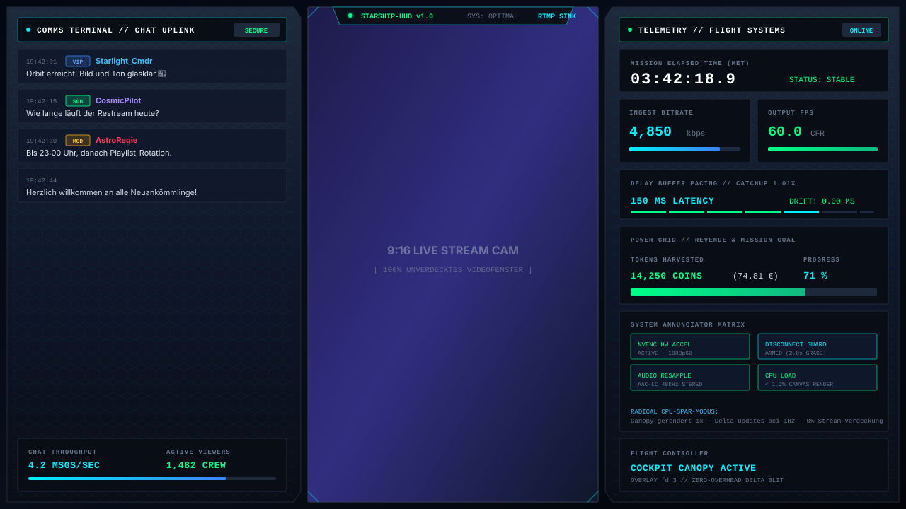
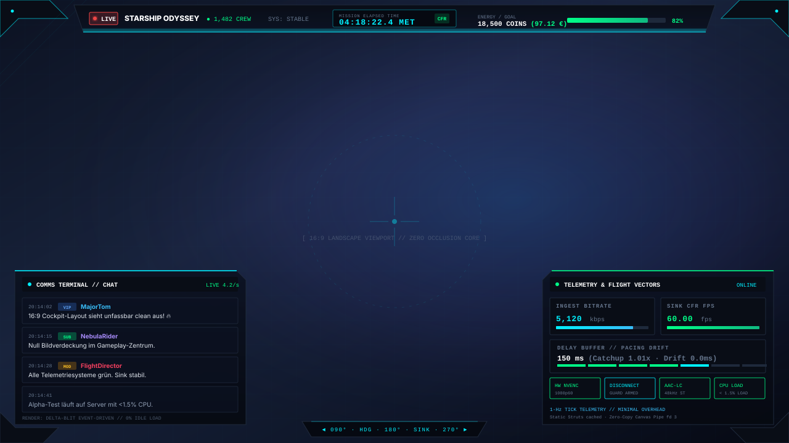

## Ziel

Ein visuell beeindruckendes, futuristisches **Starship Cockpit Canvas HUD** (Heads-Up Display) als optionales Overlay- und Regie-Layout implementieren. Das Design nutzt die toten Pillarbox-Flächen (bei 9:16-Quellen im 16:9-Stream) oder rahmt den Stream vollflächig als Sci-Fi-Raumschiff-Cockpit mit Live-Telemetrie, Statusanzeigen, Triebwerks-/Bitrate-Gauges, Missions-Timer (MET) und Funk-Chat (Comms Terminal).

Die zentrale technische Vorgabe ist ein **radikal CPU-schonendes Rendering** auf Server und Client, sodass selbst auf schwachen VPS-Servern oder Einplatinencomputern der zusätzliche CPU-Overhead für das Canvas unter **1–2 %** bleibt.

## Hintergrund & Ästhetik ("Starship Design")

- **Inspiration:** Moderne Raumfahrt-Telemetrie (SpaceX Starship Touchscreens / Dragon Cockpits) kombiniert mit klassischer Sci-Fi-HUD-Ästhetik (Cyberpunk, Elite Dangerous, Star Citizen).
- **Struktur & Rahmen (Canopy Frame):**
  - Dunkle Slate-/Carbon-Strukturrahmen (`#090d16` / `#0f172a`) mit dezenten Hexagon-Mustern (`#hex-grid`) und Eck-Verstrebungen.
  - Das eigentliche Stream-Video (9:16 oder zentriert) sitzt im Zentrum wie durch das Haupt-Cockpitfenster betrachtet – zu **100 % unverdeckt**.
- **Flugtelemetrie & Instrumente:**
  - **Missions-Timer (MET - Mission Elapsed Time):** Uptime im Monospace-Format `HH:MM:SS.s` mit Status-LED.
  - **Triebwerk / Bitrate-Instrument:** Segmentbalken und Ziffernanzeige für Ingest- und Sink-Bitrate (`4,850 kbps`).
  - **CFR / Frame-Rate Instrument:** Konstante 60.0 / 30.0 fps Überwachung.
  - **Pacing & Latency Gauge:** Delay-Puffer-Füllstand und Catch-up-Drift (150 ms Latenz, 1.01x Catchup).
  - **Energy Grid (Missionsziel / Spendenziel):** TikTok Coins / Einnahmen als Schiffs-Energiebalken mit Prozentfortschritt und Netto-EUR.
  - **Annunciator Matrix:** Kacheln für Hardware-Encoder-Status (`NVENC / QSV / x264`), Disconnect Protection (`ARMED`), Audio-Sampling (`AAC-LC 48kHz`).
  - **Comms Terminal (Chat Uplink):** Eingehende Chat-Nachrichten als verschlüsseltes Funkprotokoll mit Zeitstempeln und Rang-Badges (`VIP`, `SUB`, `MOD`, `CREW`).

## Mockups

### 1. 9:16 Säulen-Cockpit (Pillar-Box Wing HUD)

*Abbildung 1: 9:16-Quelle zentriert im 16:9-Stream. Links: Comms Terminal (Chat Uplink). Mitte: 100 % unverdecktes 9:16 Live-Fenster. Rechts: Flugtelemetrie (MET, Bitrate, FPS, Buffer-Pacing, Power Grid).*

### 2. 16:9 Vollbild-Cockpit (Landscape HUD Overlay)

*Abbildung 2: 16:9 Landscape / Fullscreen-Quelle (z. B. Gameplay/Desktop). Oben: Top-Visor Header (Status, MET, Uptime, Energy/Spendenziel). Unten links: Semi-transparenter Comms Terminal Chat. Unten rechts: Telemetrie & Vektoren. Zentraler Bildbereich bleibt zu >90 % frei.*

## Radikal CPU-schonende Architektur ("CPU-sparend")

Ein unoptimiertes Skia-Canvas-Rendering bei 1080p/720p mit 30/60 fps würde auf einer CPU schnell 15–30 % Rechenlast erzeugen. Um das Starship-Cockpit ressourceneffizient zu betreiben, greifen folgende Optimierungen:

1. **Pre-rendered Static Canopy Layer (Render-Once Buffer):**
   - Die rechenintensiven statischen Cockpit-Strukturen (Carbon-Rahmen, Schnittkanten, Hexagon-Muster, permanente Text-Labels und Skalenstriche) werden **genau einmal** in einen Offscreen-Canvas / Bitmap gerendert und im Arbeitsspeicher vorgehalten.
   - Bei Frame-Erzeugung wird das statische Canopy per extrem schnellem `memcpy` / `drawImage` als Basis kopiert, anstatt Pfade, Farbverläufe und Muster neu zu berechnen.

2. **Dirty-Rect / Delta Rendering:**
   - Dynamische Instrumente (z. B. Bitrate-Balken, MET-Sekunden, Chat-Zeilen) werden als isolierte Dirty-Rectangles behandelt.
   - Nur veränderte Bounding-Boxes werden aktualisiert; der Rest des Canvas bleibt unberührt.

3. **Tiered Event-Driven Update Loop (Kein blindes 60-fps-Polling):**
   - **Telemetrie-Ebene:** Taktet mit max. **1 Hz** (1x pro Sekunde). Sekundenzeiger, Bitrate und Uptime ändern sich nicht schneller.
   - **Chat-Ebene:** Reagiert rein ereignisgesteuert (Event-driven) bei eingehenden Nachrichten.
   - **Zero-Cost Idle:** Wenn sich keine Werte ändern und kein Chat eingeht, wird kein Frame neu gezeichnet. ffmpeg nutzt `eof_action=repeat:repeatlast=1` oder der bestehende Puffer wird unverändert wiederverwendet.

4. **Web-Cockpit im Dashboard (HTML5 / OffscreenCanvas):**
   - Im Dashboard (`DashboardView.vue` oder `StreamDeckView.vue`) läuft das Cockpit als optionale visuelle Komponente mit `OffscreenCanvas` im Web Worker oder `requestAnimationFrame`.
   - Bei `document.hidden` (Hintergrund-Tab) stoppt der Render-Loop sofort vollständig (0 % Client-CPU).

## Umfang & Umsetzung

- **Canvas-Engine (`src/core/overlays/starship-cockpit-engine.ts` oder Modus in `chat-engine.ts`):**
  - Modularer Renderer mit Layer-Caching (`canopyBuffer`, `telemetryLayer`, `commsLayer`).
  - Zuschaltbar über `settings.overlays.layout_mode: 'starship_cockpit'` oder als vorkonfigurierte Szene in `scenes.json`.
  - Anpassbare Akzentfarben (z. B. Cyan `#00f0ff`, TokTracker-Neon `#00ff88`, Amber `#f59e0b`).
- **Overlay-Studio & Presets (`OverlaysView.vue`):**
  - Schnellauswahl des "Starship Cockpit"-Presets.
  - Schalter für einzelne HUD-Module (z. B. "Comms Terminal links", "Telemetrie rechts", "Annunciator Matrix").
- **Doku & Benchmarks:**
  - CPU-Profiling-Messung vor und nach Aktivierung dokumentieren.

## Akzeptanzkriterien

- [ ] Starship Cockpit Canvas als optionaler Layout-Modus / Preset wählbar (Standard-Layout bleibt unberührt).
- [ ] Statische Canopy- und Rahmenelemente werden einmalig gecacht und nicht per-Frame neu gerendert.
- [ ] Telemetrie aktualisiert sich im 1-Hz-Takt, Chat rein ereignisbasiert.
- [ ] CPU-Mehrverbrauch des Canvas-Streamings liegt im Dauerbetrieb nachweislich unter 2 % CPU-Kernlast.
- [ ] 9:16-Live-Video bleibt im Zentrum zu 100 % sichtbar ohne Verdeckung.
- [ ] Pixelgetreue Studio-Vorschau im Overlay-Studio (`POST /api/overlays/studio.png`).
- [ ] `npm run check` grün; Unit-Tests für Rendering, Caching und Dirty-Rect-Aktualisierung.
