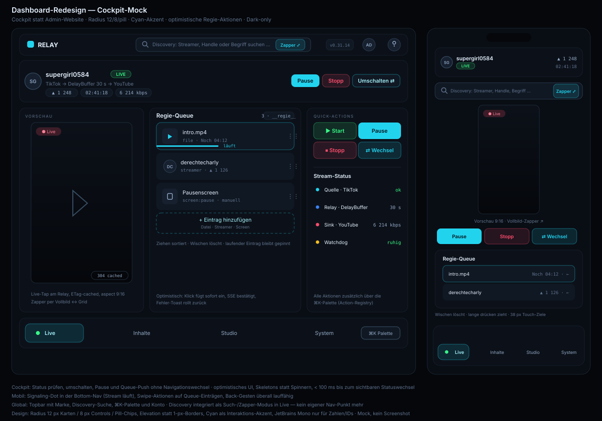

# Dashboard-Redesign: Anwenderfreundlichkeit, Geschwindigkeit und App-Gefühl

## Ziel

Das Dashboard visuell und strukturell komplett neu gestalten: schneller
bedienbar, konsistenter und mit dem Erlebnis einer nativen App (PWA) statt
einer Admin-Website. Das bestehende TokTracker-Design (harte Kanten,
1-px-Rahmen, flache Flächen) wird bewusst verlassen.

## Ausgangslage

- Das Design-System ist gut tokenisiert (`src/web/src/styles/tokens.css`),
  aber stilistisch auf 2-px-Radius/1-px-Borders festgelegt;
  `components.css` ist mit ~4.700 Zeilen (95 KB CSS) historisch gewachsen.
- Navigation: 5 Bereiche mit 13 Views; für Regie-Alltag (Umschalten, Pause,
  Queue) sind mehrere Navigationswechsel nötig.
- Interaktionen wirken an vielen Stellen wie klassisches Web: Warten auf
  Refetch statt sofortigem Feedback; Routenwechsel ohne Transition.
- Fundament für „App-Gefühl" existiert bereits: PWA mit Auto-Update,
  Lazy-Routen, Vendor-Chunk, SSE-Store, Tab-Pausierung, ETag-Caching,
  Command-Palette (unvollständig ausgebaut).

## Mockup

Schneller Design-Entwurf des Cockpit-Zustands (Desktop + Mobil), farblich
auf dem heutigen Token-Set (`--bg`, `--surface-*`, `--accent`,
`--success`, …) und den Ziel-Parametern des Issues (Radius 12/8/pill,
Elevation statt 1-px-Borders, Cyan-Akzent, Mono nur für Zahlen):

Nicht maßstäblich und kein Screenshot — dient als Diskussionsgrundlage
für Phase A/B (Tokens, Basis-Komponenten, Cockpit-Layout, Bottom-Nav
mit Signaling-Dot).

## Umfang

**Design-System (Phase A)**

- `tokens.css` neu: Elevation-Modell (3 Flächen-Ebenen) statt reiner
  Border-Hierarchie, Radius 10-14 px (Karten) / 8 px (Controls) / 999 px
  (Chips), Cyan als Interaktions-Akzent plus semantische Farben (live/ok/warn).
- JetBrains Mono nur noch für Zahlen/IDs/Timestamps, nicht für Labels.
- Basis-Komponenten mit Varianten-API (Button, Card, Field, Badge, ListItem,
  Skeleton, Toast); bestehende Einzelkomponenten darauf migrieren.
- View-Transitions bei Routenwechseln, `prefers-reduced-motion` respektiert.

**Cockpit & IA (Phase B)**

- Dashboard als Cockpit: sticky Status-Header (Ziel, Uptime, Zuschauer,
  Bitrate), Vorschau, Quick-Actions für Regie-Top-Tasks, kompakte Queue.
- Navigation von 5 auf 4 Bereiche straffen; Discovery als Such-/Zapper-Modus
  in Live integrieren (Zapper bleibt als Fullscreen-Modus mit Zurück-Navigation).
- Flache Routen und Deep Links bleiben unverändert.
- Command Palette zur ersten Klasse: eine Action-Registry speist Palette,
  Kontextmenüs und Buttons.

**Interaktion & Speed**

- Optimistic UI für Queue, Screens, Zeitplan, Overlay-Slider: sofort
  umschalten, SSE bestätigt, Fehler-Toast rollet zurück.
- Route-Prä-Fetch on hover/pointerdown für die Hauptziele; Skeletons statt
  Spinnern; Interaction-Ziel: „Umschalten" → sichtbarer Statuswechsel < 100 ms.
- Mobil: Swipe-Aktionen für Queue-Einträge, Signaling-Dot (Stream läuft) in
  der Bottom-Nav, Back-Gesten überall lauffähig.

**Aufräumen (Phase D)**

- `components.css` konkurrenzlos verkleinern (Ziel < 2.000 Zeilen) durch
  Varianten-Klassen statt Duplikaten.
- E2E-Tests (320-px-Overflow, Formular-Labels, Navigation, Theme-Wechsel) an
  das neue Design anpassen; `docs/ACCESSIBILITY.md`, `AGENTS.md` und
  README-Stilabschnitte aktualisieren.
- Overlay-Studio: Drag/Resize und Presets beibehalten; mobile Editor-Dichte
  (Accordions) besser strukturieren.

## Abgrenzungen

- Overlay-Ausgaben im Stream (Chat-Canvas, Templates) bleiben unberührt; nur
  das Dashboard-Studio wird neu gegliedert.
- Backend-API und SSE-Payloads ändern sich nicht, außer es entstehen neue
  Aktionen für die Action-Registry.
- Stream-Deck-/Deck-Layout bleibt unberührt.
- Light-Theme-Variante: offengehalten — vorerst Dark-only als Default, Light
  als Follow-up.

## Akzeptanzkriterien

- [ ] Neues Tokenset und Basis-Komponenten sind in `src/web/src/styles` bzw.
      `components/` umgesetzt und für alle Views verpflichtend.
- [ ] Alle 13 Views laufen auf den neuen Basis-Komponenten ohne visuelle
      Alt-Reste (`grep` auf veraltete Klassen/Styles demonstriert Cleanup).
- [ ] Routenwechsel zeigen View-Transitions (mit Respekt für
      `prefers-reduced-motion`).
- [ ] Regie-Alltag (Status prüfen, umschalten, Pause, Queue-Push) ist ohne
      Navigationswechsel ausführbar.
- [ ] Optimistisches UI umgesetzt für Queue, Screens und Zeitplan inkl.
      Rollback bei Server-Fehler (getestet).
- [ ] `npm run check` und `npm run build` sind grün, E2E-Tests sind an das
      neue Design angepasst.
- [ ] AGENTS.md, README/Stil-Doku und PROCESS der Roadmap sind aktualisiert.
